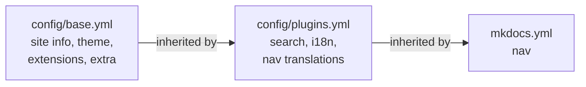

# Charted Docs

My BSc thesis on Charted, a self-hosted social hiking app, published as a bilingual documentation site with MkDocs.

## Relevant Links

- **Live site (English):** [pinterbarni.github.io/charted-docs](https://pinterbarni.github.io/charted-docs/)
- **Live site (Hungarian):** [pinterbarni.github.io/charted-docs/latest/hu](https://pinterbarni.github.io/charted-docs/latest/hu/)
- **Workflow runs:** [GitHub Actions](https://github.com/pinterbarni/charted-docs/actions)

## Contents

- [Charted Docs](#charted-docs)
  - [Relevant Links](#relevant-links)
  - [Contents](#contents)
  - [How it works](#how-it-works)
    - [Languages](#languages)
    - [Versions](#versions)
    - [Configuration](#configuration)
  - [Repository structure](#repository-structure)
  - [Run locally](#run-locally)
  - [Writing content](#writing-content)
    - [Adding a page](#adding-a-page)
    - [Finishing a page](#finishing-a-page)
    - [Spell checking](#spell-checking)
  - [CI](#ci)
    - [Build (strict)](#build-strict)
    - [Links](#links)
    - [Deploy to GitHub Pages](#deploy-to-github-pages)
    - [Content and Descriptions](#content-and-descriptions)
    - [Spelling](#spelling)
    - [ShellCheck](#shellcheck)
  - [Branching and commits](#branching-and-commits)
  - [Built with](#built-with)

## How it works

The site is built with [MkDocs](https://www.mkdocs.org) and the [Material for MkDocs](https://squidfunk.github.io/mkdocs-material/) theme, versioned with [mike](https://github.com/jimporter/mike) and published to GitHub Pages by GitHub Actions. Python dependencies are managed with [uv](https://docs.astral.sh/uv/).

### Languages

English is the default language and lives at the site root. Hungarian lives under `/hu/`. Every page exists as a pair of files side by side, `name.en.md` and `name.hu.md`, handled by [mkdocs-static-i18n](https://github.com/ultrabug/mkdocs-static-i18n). If a Hungarian page is missing, the English one is shown instead. The language switcher in the header keeps you on the same page.

### Versions

mike publishes each version into its own folder on the `gh-pages` branch. Currently there is one version, `latest`, built from `main` and set as the default, so the site root redirects to it. A frozen `submitted` version (the thesis as handed in) is planned.

### Configuration

The MkDocs config is split into three files chained with `INHERIT`. Each key lives in exactly one file, because lists such as `plugins` are replaced, not merged, when files are combined.



- **`config/base.yml`:** site name and URLs, footer, theme and features, Markdown extensions, version selector. Rarely changes.
- **`config/plugins.yml`:** search, the i18n plugin, the Hungarian footer and the Hungarian nav labels.
- **`mkdocs.yml`:** the entry point and the nav. This is what you edit when adding pages.

## Repository structure

```bash
charted-docs/
├── .github/workflows/
│   ├── docs.yml                 triggers, job order and permissions
│   ├── _build.yml               strict build
│   ├── _deploy.yml              deploy to GitHub Pages with mike
│   ├── _links.yml               internal link check
│   ├── _progress.yml            content progress report
│   ├── _shellcheck.yml          lints the scripts in scripts/
│   └── _spellcheck.yml          spell check report
├── .vscode/settings.json        editor colors and YAML schema
├── config/
│   ├── base.yml
│   └── plugins.yml
├── docs/                        the site content, one .en.md and .hu.md pair per page
│   ├── index.*.md               home page
│   ├── introduction/
│   ├── user-guide/
│   ├── developer-guide/         design, architecture, backend, mobile, deployment, test cases
│   └── summary/
├── scripts/
│   ├── lib/
│   │   ├── config.sh            shared values: languages and placeholder markers
│   │   ├── front-matter.sh      reads page front matter
│   │   ├── format.sh            percentage and progress bar formatting
│   │   └── report.sh            per-language counting and CI summary output
│   ├── content-progress.sh      counts pages still marked todo per language
│   ├── description-progress.sh  counts pages without a real description per language
│   └── progress.sh              runs every report, for local use
├── cspell.json                  spell check words and the Hungarian override
├── cspell.ci.json               CI spell check config with the Hungarian dictionary
├── mkdocs.yml
├── pyproject.toml               Python dependencies
├── uv.lock                      pinned dependency tree
└── .python-version              Python version used locally and in CI
```

## Run locally

Requires [uv](https://docs.astral.sh/uv/). Install the dependencies once:

```bash
uv sync
```

Preview the site with live reload at `http://127.0.0.1:8000` (English) and `http://127.0.0.1:8000/hu/` (Hungarian):

```bash
uv run mkdocs serve
```

Run the same strict build that CI runs. It fails on broken links, missing nav files and other warnings:

```bash
uv run mkdocs build --strict
```

Show the progress reports for every language, content and descriptions together. `progress.sh` is meant for local use; CI runs each report as its own job:

```bash
bash scripts/progress.sh
```

Preview the deployed versions with the version selector, served from the `gh-pages` branch:

```bash
git fetch origin gh-pages
uv run mike serve
```

Lint the scripts the same way CI does (requires [ShellCheck](https://www.shellcheck.net)):

```bash
shellcheck -x scripts/*.sh scripts/lib/*.sh
```

Spell check project locally with cspell.

```bash
npx --yes -p cspell@9 -p @cspell/dict-hu-hu cspell --config cspell.ci.json "docs/**/*.md"
```


To hide the Material end-of-life banner in the terminal, set `NO_MKDOCS_2_WARNING=1`.

## Writing content

### Adding a page

Create both language files with front matter marking the page as unfinished:

```markdown
---
todo: true
description: TODO
---

# Page title

TODO
```

Then add the page to the `nav` in `mkdocs.yml` (without the language suffix, for example `introduction/charted-app.md`) and its Hungarian label to `nav_translations` in `config/plugins.yml`. The label key must match the English nav label exactly.

### Finishing a page

Remove the `todo: true` line from the front matter, and replace `description: TODO` with a one-line summary of the page. The description appears on the section index cards, in search results and in link previews. The progress reports only look at the front matter, so the visible TODO text and anything else in the page body never affect them.

### Spell checking

Project words live in `cspell.json`, shared by the editor and CI. English is checked everywhere, and `.hu.md` files are checked in Hungarian as well. In VS Code, install the Code Spell Checker extension and its "Hungarian - Code Spell Checker" add-on, and add new words with the "Add to config: cspell.json" quick fix. To run the CI check locally (requires Node):

```bash
npx --yes -p cspell@9 -p @cspell/dict-hu-hu cspell --config cspell.ci.json "docs/**/*.md"
```

## CI

`docs.yml` runs on every push to `main` and on manual dispatch. It holds the triggers and the job order, and calls four reusable workflows (the files starting with `_`). The whole workflow is read-only by default, and only the deploy gets write access.

### Build (strict)

Installs the locked dependencies and runs `mkdocs build --strict`. Deploy only runs if this passes, so a broken page never reaches the live site.

### Links

Runs after Build. It builds the site, serves it under the same path GitHub Pages uses and crawls every internal link, including links generated by templates, which the strict build doesn't check. Deploy waits for it, so a broken link never reaches the live site.

### Deploy to GitHub Pages

Runs after Build. It deploys the site as `latest` with mike, sets it as the default version and writes the live URLs into the run summary. The job is linked to the `docs` environment, so the live URL also appears in the repository's Deployments.

### Content and Descriptions

Two report-only jobs that run in parallel with Build and never block anything. Content counts pages still marked `todo: true`, and Descriptions counts pages whose description is missing, empty or still `TODO`.

### Spelling

Runs in parallel with Build and never blocks anything. It checks all pages with cspell and the Hungarian dictionary and lists unknown words in the run summary.

### ShellCheck

Runs in parallel with everything else. It lints every script in `scripts/` with ShellCheck and fails on any finding. Deploy doesn't wait for it, since the scripts only produce reports and never affect the site.

## Branching and commits

- Work happens on short-lived branches created from an up-to-date `main`, named after the change: `docs/...`, `ci/...`, `chore/...`, `fix/...`.  
- Commits are small, one idea each, and follow [Conventional Commits](https://www.conventionalcommits.org) (`docs:`, `ci:`, `chore:`, `fix:`).  
- Finished branches are merged into `main` with `git merge --no-ff`, which keeps the individual commits and groups them under one merge commit. Every merge into `main` deploys once.

## Built with

[MkDocs](https://www.mkdocs.org), [Material for MkDocs](https://squidfunk.github.io/mkdocs-material/), [mkdocs-static-i18n](https://github.com/ultrabug/mkdocs-static-i18n), [mike](https://github.com/jimporter/mike), [Mermaid](https://mermaid.js.org) and [uv](https://docs.astral.sh/uv/).
