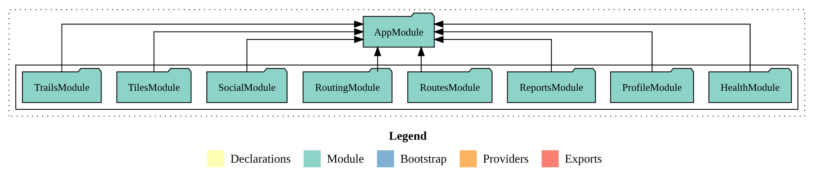

# Modulstruktúra

A BFF alkalmazás NestJS moduláris architektúrára épül. Az `AppModule` gyökérmodul regisztrálja az összes feature modult és a globális infrastruktúrát, beleértve a konfigurációkezelést, az adatbázis-kapcsolatot, a rate limitinget, a strukturált naplózást és a globális `JWT` autentikációs guard-ot.

/// caption
    attrs: {id: fig-module-structure}
A NestJS BFF modulstruktúrája (Compodoc)
///

Az alkalmazás az alábbi feature modulokból áll:

| Modul | Leírás |
|---|---|
| `HealthModule` | Publikus health check végpont, autentikáció nélkül elérhető. A Docker Compose `healthcheck` konfigurációja ezt a végpontot kérdezi le a konténer állapotának meghatározásához. |
| `TilesModule` | Martin tile server proxy modul. A tile válaszok `Cache-Control` fejléccel vannak ellátva 24 órás érvényességgel. A végpontok ki vannak zárva a Swagger dokumentációból, mivel belső proxy végpontok. *(Deprekált: A Martin API kulcsot szerver oldalon injektálta minden proxyzott kérésbe, így az soha nem kerül ki a kliens oldalra.)* |
| `RoutingModule` | Valhalla routing engine proxy modul. A gyalogos útvonaltervezési kéréseket irányítja a Valhalla felé, és a Valhalla hibáit közvetlenül továbbítja a kliensnek. A frontend jelenleg részlegesen használja, teljes integráció V2-re tervezett. |
| `RoutesModule` | Tervezett útvonalak kezelése. Valhalla hívást indít az útvonal kiszámításához, majd a teljes Valhalla választ `jsonb` típusban perzisztálja PostgreSQL-be. Az útvonalak a bejelentkezett felhasználóhoz vannak kötve. |
| `ProfileModule` | Felhasználói profil és avatar kezelés, felhasználókeresés. A profil az első bejelentkezéskor automatikusan létrejön upsert művelettel, a Keycloak JWT `sub` claim-et használva elsődleges kulcsként. Az avatar adatok külön táblában tárolódnak, hogy a profil lekérések ne hozzák magukkal a nagy méretű képadatot. A felhasználókeresés kiszűri a blokkolt felhasználókat az eredményekből. Két controller kezeli: `ProfileController` a profil műveletekhez, `AvatarController` az avatar műveletekhez. Az avatar műveletek le lettek választva, hogy ezzel is áramvonalasítsuk a lekérdezéseket. Jelenleg Base64 kódolással tároljuk, bár a felhasználó entitásoknak már létrehoztunk egy URL mezőt, hogy a következő verzióban már URL segítségével lehessen profilképeket tárolni. |
| `TrailsModule` | Túrák CRUD műveletei, megosztás és like funkciók. By design, három külön controllerre van bontva felelősségi körök szerint: `TrailsController` az alap CRUD műveletekhez, `TrailsLikesController` a like/unlike műveletekhez, `TrailsSharedController` a publikus felfedezési feedekhez. A trail létrehozásakor automatikusan inkrementálódik a felhasználó `totalDistanceM` értéke, amelyből a gamifikációs szint kerül kiszámításra. Fontos megjegyzés: a távolság törléskor soha nem csökken. |
| `SocialModule` | Követés, blokkolás és publikus profil megtekintés. Három controller kezeli: `SocialFollowController` a követési műveletekhez, `SocialBlockController` a blokkolási műveletekhez, `SocialProfileController` a publikus profilok lekéréséhez. A blokkolás automatikusan eltávolítja az összes kölcsönös követési kapcsolatot. A blokkolt felhasználók számára minden esetben `NotFoundException` kerül visszaadásra, a blokk ténye soha nem kerül felfedésre. |
| `ReportsModule` | Felhasználók és túrák bejelentése moderációs célból. Tartalmaz admin végpontot is a moderátori válasz hozzáadásához. |

A modulok közötti függőségek a következőképpen alakulnak: a `SocialModule` és a `TrailsModule` egyaránt importálja a `ProfileModule`-t, mivel a felhasználói adatok eléréséhez szükséges a `UserEntity` repository és a `SocialBlockService`.

A BFF modulstruktúrájának részletes vizuális ábrázolása a Compodoc dokumentációból érhető el. A dokumentáció generálásához és megtekintéséhez lásd a projekt `README.md` fájlját.
