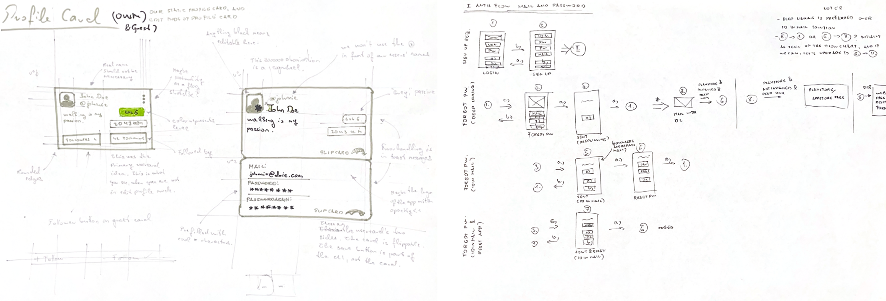
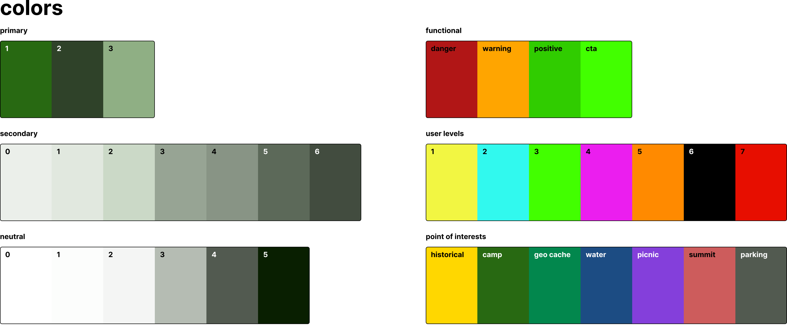
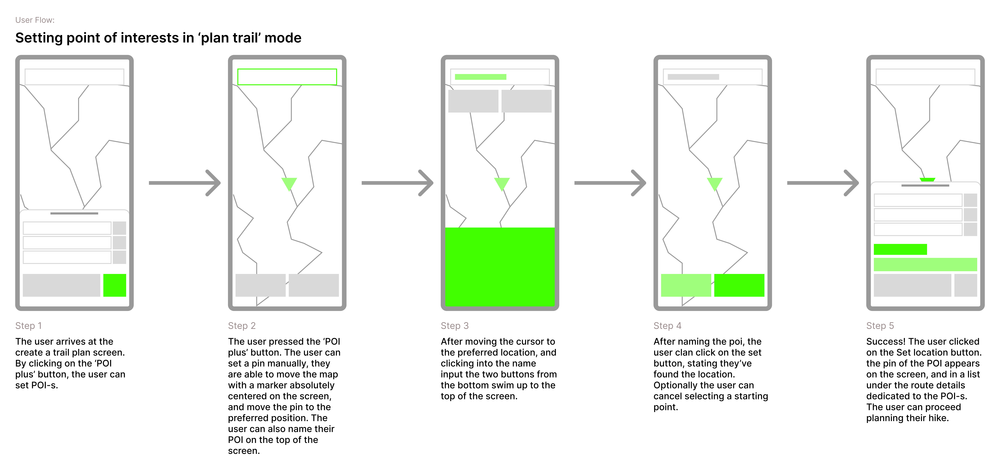
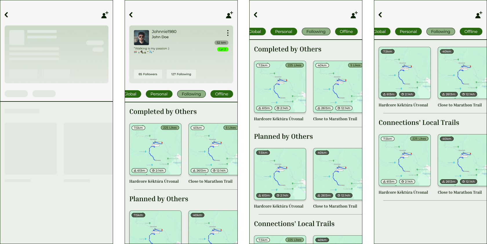
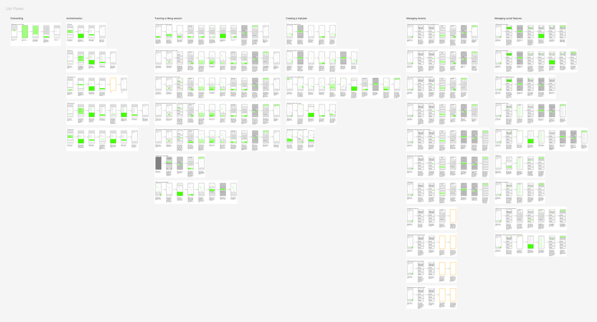
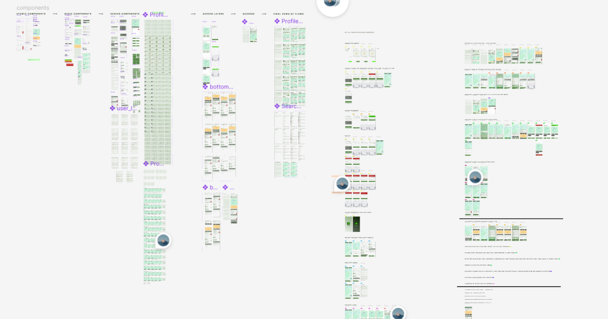
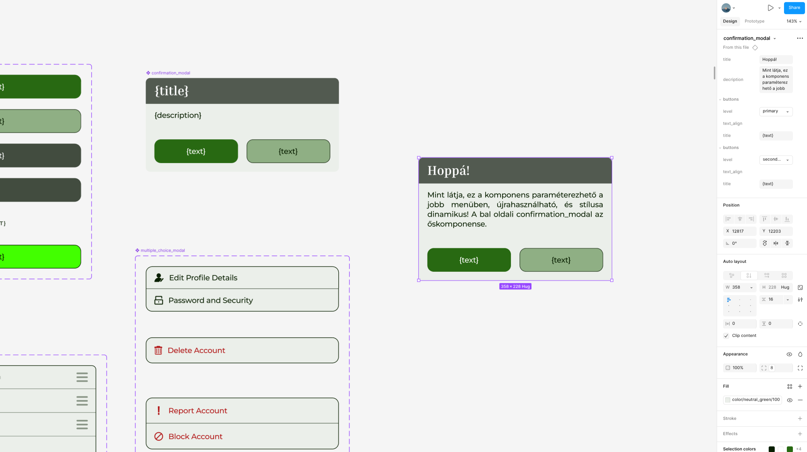

# UI/UX tervezés

A fejlesztés tervezési fázisa a meglévő térképes alkalmazások vizsgálatával kezdődött, majd papíralapú vázlatokon keresztül jutott el a végleges, Figma környezetben elkészült felhasználói felületig és komponensrendszerig.

--8<-- "web-addition.hu.md"

## Kutatás, keresés és inspirálódás

A fejlesztési folyamat kezdetén a cél egy túraalkalmazás megtervezése volt, amely mobilplatformokra készül. Ennek megfelelően első lépésként a jelenleg elérhető, térképes funkcionalitással rendelkező mobilalkalmazások vizsgálatát végeztem el, különös tekintettel azok funkcionalitására és felhasználói felületére.

Az elemzés során több különböző kategóriába tartozó alkalmazást vizsgáltam meg: túraalkalmazások (például AllTrails), futó- és aktivitáskövető alkalmazások (mint a Strava és a Nike Run Club), valamint általános térképes navigációs alkalmazások (mint a Google Maps és az Apple Maps). Ez a vizsgálat szolgált a teljes tervezési folyamat kiindulási alapjául.

## Megfigyelések

A vizsgált alkalmazások közül különösen a Google Maps és az Apple Maps esetében volt megfigyelhető, hogy a felhasználói élmény középpontjában egyértelműen a térkép áll. Az alkalmazás megnyitását követően a felhasználó azonnal a térképes nézetbe kerül, és minden egyéb funkció másodlagos szerepet kap. Az információk többsége mélyebben helyezkedik el a felületen, és jellemzően alsó navigációs sávon keresztül érhető el. Ez a navigációs és felépítési minta közvetlen hatással volt a saját alkalmazásom felhasználói folyamatainak kialakítására.

## Autentikációs döntés

A tervezés során fontos kérdés volt, hogy az alkalmazás használata autentikációhoz kötött legyen-e. Mivel az alkalmazást egy potenciálisan monetizálható termékként terveztem, ezért a használatot autentikációhoz kötöttem. A kezdeti tervek között szerepelt a Firebase Authentication használata, azonban a végleges megoldásban Keycloak került alkalmazásra. Az autentikációs képernyő egyben töltőképernyőként is funkcionál, így másodlagos szerepet kap az alkalmazás inicializációs folyamatában.

## Vizuális irányelvek

Az alkalmazás vizuális kialakítása során tudatos döntés volt, hogy a meglévő, ismert alkalmazások megjelenéséhez igazodjak, ezáltal egy ismerős és könnyen használható felhasználói élményt biztosítva. Az alkalmazás színvilágának kialakításakor személyes szempontok is szerepet játszottak a választott színek egy gyermekkori kerékpár színéhez igazodnak. Az alkalmazás ikonja kizárólag demonstrációs céllal készült el, nem végleges dizájnelemként.

## Papíralapú tervezés

A tervezés első lépése a felhasználói folyamatok papíralapú megtervezésével kezdődött. Toll és színes filcek segítségével vázoltam fel az alapvető működést, különös tekintettel az autentikációs folyamatra, valamint arra, hogy a felhasználó milyen módon interaktál az alkalmazással. A tervezés során cél volt, hogy az alkalmazás tartalmazzon egy emlékszerű, a valós életből inspirálódó elemet is ennek eredményeként egy ID kártyára hasonlító felhasználói komponens került megtervezésre.

/// caption
Papíralapú tervezés: autentikációs folyamat vázlata és egy komponens terv
///

## Tipográfia

A dizájnrendszer kialakításakor kiemelt szerepet kapott a tipográfia. A cél egy olyan vizuális világ megteremtése volt, amely egyszerre barátságos, könnyen használható, ugyanakkor professzionális és kifinomult. A heading elemekhez Inria Serif, a body és label elemekhez Montserrat betűtípus került kiválasztásra. A döntés mögött az a megfontolás állt, hogy a sans-serif betűtípusok könnyebben olvashatóak digitális kijelzőkön, míg a serif betűtípusok professzionálisabb, karakteresebb megjelenést biztosítanak. A tipográfiai rendszer három szintből épül fel: heading (h1-h5), body (p1-p3) és label (l1-l3), mindegyik Regular és Medium súlyváltozatban.

/// caption
A Charted tipográfiai rendszere
///

## Színpaletta

A színpaletta kialakításakor monokróm megközelítést alkalmaztam, mivel ez egyszerűbb implementációt és konzisztens vizuális rendszert tesz lehetővé. A háttérszínek földtónusokra épülnek, enyhén zöldes árnyalatokkal. Ezeket egészíti ki egy erősen szaturált neonzöld szín, amely a call-to-action elemeknél kerül felhasználásra, valamint egy mélyebb zöld árnyalat, amely kontrasztot biztosít. A színrendszer tartalmaz figyelmeztető színeket is (danger, warning, positive, cta), valamint POI típusonként eltérő színkódokat (historical, camp, geo cache, water, picnic, summit, parking).

/// caption
A Charted színpalettája
///

Az alkalmazás árnyékolási megoldásai szintén a meghatározott színskálán alapulnak: az árnyékok nem semleges fekete, hanem sötétzöld árnyalatú színekkel kerültek megvalósításra, ezzel biztosítva, hogy az elemek vizuálisan illeszkedjenek a környező felületekhez és a valós árnyékhatások természetbeli megjelenését kövessék.

## Felhasználói folyamatok és wireframek

A tipográfia és színrendszer meghatározása után a felhasználói folyamatok wireframe szintű megtervezése következett. A wireframek célja kettős volt: egyik, a logikai hibák korai kiszűrése, másik a szükséges komponensek azonosítása és megértése. A [példa wireframe](#wireframe-example) ábrán egy konkrét user flow látható, a POI elhelyezés folyamata túratervezés közben, öt lépésben ábrázolva.

/// caption
    attrs: {id: wireframe-example}
Felhasználói folyamat wireframe: POI elhelyezése túratervezés közben
///

A wireframe alapján készült el később a teljesen designolt változat, ahol a valós színek, tipográfia és komponensek már megjelennek. Az [alábbi ábrán](#user-flow-final) a végleges, designolt user flow látható.

/// caption
    attrs: {id: user-flow-final}
Végleges, teljesen designolt felhasználói folyamat
///

Az [alábbi ábrán](#fig-all-user-flows) az összes összegyűjtött, tervezett felhasználói folyamat látható.

/// caption
    attrs: {id: fig-all-user-flows}
A teljes Figma wireframe-gyűjtemény áttekintése
///

## Komponens alapú tervezés

A felhasználói folyamatok megtervezése után következett a komponenskönyvtár kialakítása. A Figma komponensrendszerét használva olyan elemeket hoztam létre, amelyek paraméterezhetőek és különböző variációkban alkalmazhatóak. Különböző hierarchiájú gombok kerültek kialakításra (elsődlegestől negyedleges szintig), kisebb komponensekből nagyobb UI elemek épültek fel, ezekből pedig teljes nézet prototípusok készültek. A platform ajánlásokat figyelembe véve egységesen 16 px margót alkalmaztam, amely az alkalmazás teljes felületén konzisztensen megjelenik.

Az [alábbi ábrán](#components-excerpt). ábrán a Figma munkaterület egy szekciója látható, amelyen a komponensek, képernyők és felhasználói folyamatok hierarchikus felépítése figyelhető meg.

/// caption
    attrs: {id: components-excerpt}
Komponensek és képernyők a Figma munkaterületen
///

A komponensek paraméterezhetőek: a jobb oldali Figma panelen a szövegek, gombok szintje és egyéb tulajdonságok dinamikusan állíthatóak. Az [alábbi ábrán](#parameterable-component) ábrán egy ilyen paraméterezhetőkomponens példája látható, a `confirmation\modal`, amelynek gombjainak szintje, szövege és leírása dinamikusan változtatható.

/// caption
    attrs: {id: parameterable-component}
Paraméterezhető komponens példa: confirmation\_modal
///

A tervezés során Figma pluginokat is alkalmaztam, amelyek lehetővé tették a designok valós telefon mockupokban való megjelenítését. Az [alábbi ábrán](#plugin-example) ábrán egy ilyen render látható.

/// caption
    attrs: {id: plugin-example}
Figma plugin alapú telefon mockup render
///

## Prototípusok és iteráció

Az alkalmazás ikonjait egyedi SVG alapú komponensekként hoztam létre, amelyek a dizájnrendszer részét képezik. Az ikonok paraméterezhetőek, és a színrendszerrel összhangban kerültek kialakításra.

A verziókezelés nem minden esetben történt ideális módon, és a fejlesztés során a scope változása miatt több ponton eltérés történt az eredeti tervektől. Ennek ellenére a kialakított design rendszer stabil alapot biztosított a további fejlesztéshez. A tipográfia és színrendszer paraméterezve került kialakításra, hogy könnyen átültethető legyen a megvalósítás során.

## Technikai megjegyzések

A tervezés során kihívást jelentett, hogy a Figma relatív méretezési rendszert használ, míg a React Native abszolút értékekkel dolgozik, ami bizonyos esetekben nehezítette az értékek pontos átvitelét. A komponensalapú tervezés során jelent meg a Figma *Variables* funkciója, amely lehetővé teszi különböző témák (pl. light/dark mód) és paraméterek (pl. színek, lekerekítések) központi kezelését. Ez jelentősen megkönnyítené a design rendszer skálázhatóságát a jövőben.

Megjegyzendő, hogy a sötét mód színpalettája a tervezési fázisban nem került részletesen kidolgozásra. A jelenleg implementált sötét módban megjelenő értékek elsősorban a funkcionalitás tesztelésére szolgálnak, és nem tekinthetők végleges dizájndöntéseknek.

A tervezés és implementáció közötti átültetés során további nehézséget okozott a Figma és a React Native eltérő méretezési modellje. A betűméretek és sortávolságok esetében a Figma relatív, képernyőfüggő értékeket használ, míg a React Native abszolút pixelértékekkel dolgozik, ezért a tipográfiai értékek csak közelítőleg vihetők át. Hasonló eltéréssel találkoztam a lekerekítési értékeknél is: a Figma komponensekben beállított `border-radius` értékek és a React Native `StyleSheet`-ben szereplő megfelelőik között kisebb különbségek maradtak, ezek a komponensek vizuális megjelenésén minimálisan érzékelhetők.
