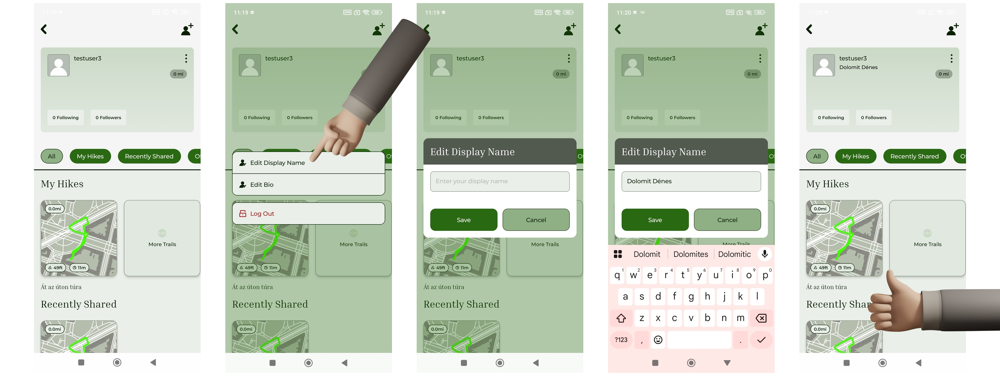
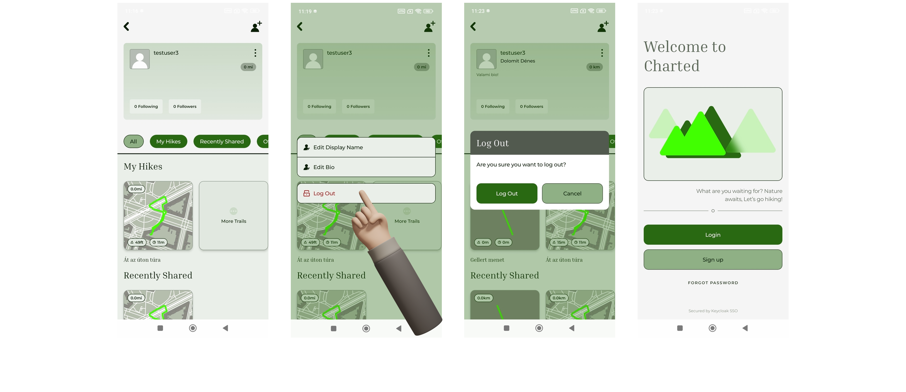

# Profil és beállítások

A felhasználó a profil felületen megtekintheti és módosíthatja a fiókjához tartozó alapadatokat.

## Profil adatok megtekintése

A profil oldalon a felhasználó láthatja saját adatait, valamint a hozzá tartozó statisztikákat és túrákat.

## Megjelenített név módosítása

A felhasználó lehetőséget kap a megjelenített nevének (display name) megadására vagy módosítására. A módosítás egy szerkesztő felületen történik, ahol a megadott név mentés után azonnal frissül a profil oldalon megjelenített adat.

/// caption
Megjelenített név módosítása lépésenként
///

## Bio módosítása

A felhasználó egy rövid bemutatkozó szöveget (bio) adhat meg vagy módosíthat. A bio opcionális mező, amely üresen is hagyható. A módosítás mentés után azonnal megjelenik a profil felületen.

/// caption
Bio módosítás folyamata
///

## Jelszó módosítása

A jelszó módosítása nem közvetlenül az alkalmazáson belül történik. A felhasználó az „elfelejtett jelszó" funkción keresztül kezdeményezheti a jelszó megváltoztatását, amely egy webes felületen valósul meg. A folyamat részletes leírása a [Regisztráció és bejelentkezés](sign-up-and-sign-in.md) szakaszban található. Ennek oka, hogy bár az alkalmazás működése alapvetően folyamatos, bejelentkezett állapotban maradásra épül, így a jelszó módosítása nem gyakran használt funkció a felhasználói felületen.

## Kijelentkezés

A felhasználó a profil felületen keresztül kijelentkezhet az alkalmazásból. Kijelentkezés után az alkalmazás visszanavigál a bejelentkezési képernyőre, és az autentikált állapot megszűnik.

/// caption
Kijelentkezési folyamata
///
