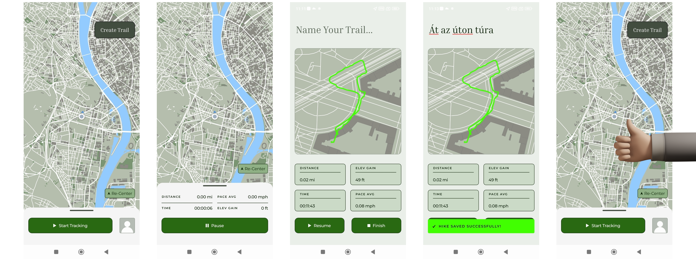
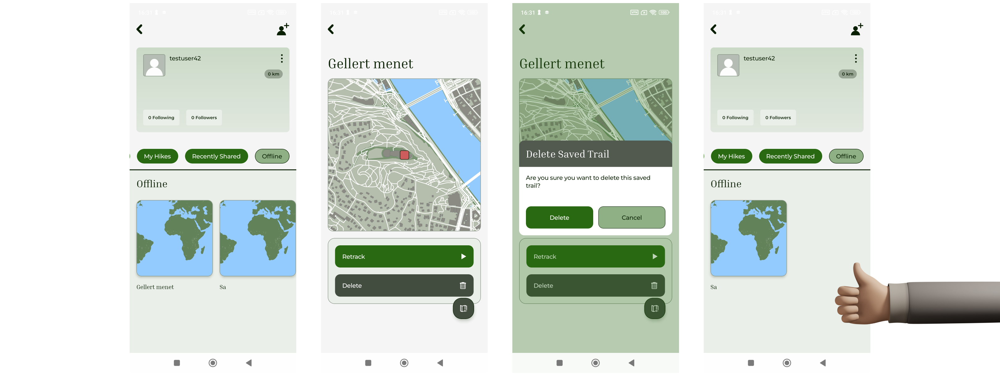

# Túra rögzítése és mentése

Az alkalmazás lehetőséget biztosít a felhasználó számára túrák valós idejű rögzítésére és mentésére.

Az új túra indításának előfeltétele, hogy a felhasználó legalább egy, az alkalmazás valamilyen lokációs adatokhoz való hozzáférését elfogadja. A legjobb felhasználói élmény érdekében érdemes elfogadni az elő- és háttérbeli helyhozzáférést, illetve az értesítéseket is, így az alkalmazás akár figyelmeztetni is tudja a felhasználót, ha elfelejtette volna lekapcsolni a túra követését.

## Túra indítása

A felhasználó kétféle módon indíthat túrát:

- azonnali indítással a térkép nézetből,
- egy korábban tervezett túratervezet betöltésével (retrack mód, a tervezett túraútvonalakhoz).

Az indítást követően a felugró panelen megjelenik egy számláló, az alkalmazás megkezdi a felhasználó mozgásának követését, a bejárt útvonal kirajzolódik a térképen. A rögzítés, szüneteltetés, befejezés és mentés folyamata az [alábbi ábrán](#fig-flow-track-save) követhető nyomon.

## Rögzítés közbeni működés

A rögzítés során:

- a megtett útvonal folyamatosan kirajzolódik a térképen,
- a rendszer gyűjti a túrához tartozó adatokat. (Pl. távolság, idő, lehelyezett POI-k.)

## Szüneteltetés és folytatás

A felhasználó lehetőséget kap a rögzítés szüneteltetésére a szüneteltetés gomb megnyomásával. Szüneteltetett állapotból a túra bármikor folytatható vagy befejezhető.

## Túra befejezése

A túra befejezése szándékos felhasználói cél bizonyításához kötött. Előfeltétele, hogy a felhasználó elnevezze az útvonalát, és a mentés is csak hosszú gombnyomás után érhető el, ez csökkenti a véletlen megszakítás lehetőségét.

## Túra mentése

A túra befejezése után a felhasználónak kötelező nevet megadnia a mentéshez.

Sikeres mentés után:

- a túra eltárolásra kerül,
- a felhasználó visszajelzést kap a mentés sikerességéről.

/// caption
    attrs: {id: fig-flow-track-save}
Túra indítása, rögzítése, szüneteltetése, befejezése és mentése
///

## Túra vagy túratervezet törlése

A felhasználónak lehetőséget adunk túrák és túratervek törlésére. Erre a túra részletes megtekintésére kialakított oldalon van lehetőség.

Fontos:

- a felhasználó csak a saját túráit törölheti,
- a felhasználó visszajelzést kap a törlés sikerességéről,
- a felhasználó csak sikeres megerősítés után törölhet.

/// caption
Egy mentett túratervezet törlése
///
