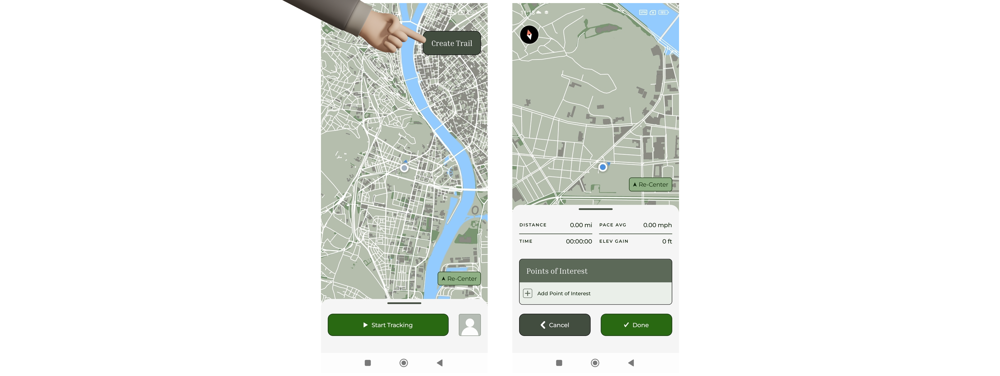
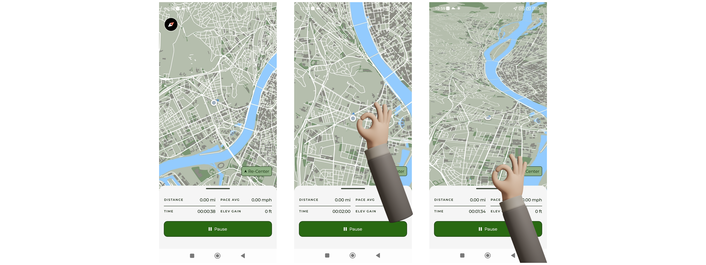
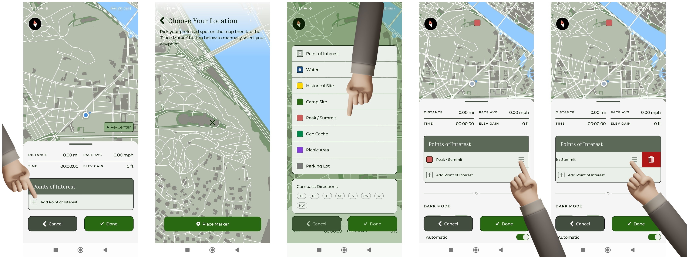
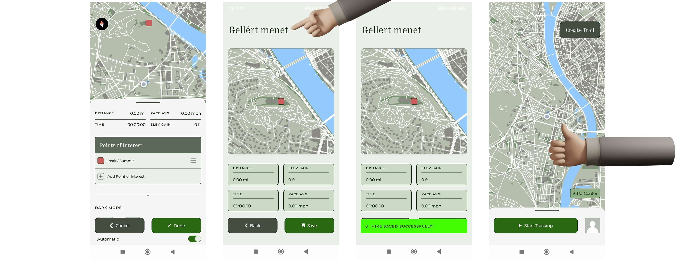
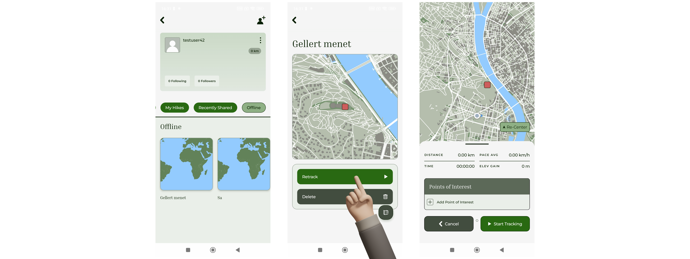

# Túraútvonal tervezése

Az alkalmazás lehetőséget biztosít egyéni túraútvonalak tervezésére és mentésére.

## Útvonal tervezés indítása

A felhasználó a térkép nézetben elérhető, jobb felső sarokban található "Create trail" gomb segítségével indíthat új túra tervezést.

Az új túra tervezésének előfeltétele, hogy a felhasználó legalább egy, az alkalmazás valamilyen lokációs adatokhoz való hozzáférését elfogadja. A legjobb felhasználói élmény érdekében érdemes elfogadni az elő- és háttérbeli helyhozzáférést, így a felhasználó akár mások által bejárt útvonalakat is láthat.

/// caption
Túratervezés indítása
///

## Térkép forgatása, döntése

A felhasználónak lehetősége van két ujj lenyomva tartásával a térkép elforgatására. Az elforgatott térképen egy iránytű jelenik meg a jobb felső sarokban, ezzel is segítve a felhasználót a navigációban. A felhasználónak lehetősége van két ujját nyomva tartva a kamera dőlésszögének változtatására is.

/// caption
Térkép forgatása és döntése
///

## Pontok (POI-k) elhelyezése

A tervezés során a felhasználó pontokat (Point of Interest, röviden POI) helyezhet el a térképen. A pontok kijelölik a tervezett útvonal fő állomásait, nevezetességeit. A felhasználónak továbbá lehetősége van elágazásoknál égtájjelölők elhelyezésére is, melyek segítségével a tervezett haladás irányát jelölheti meg.

A pontok:

- térképre helyezhetők,
- törölhetők, hogy módosíthassuk.

A térképen lehelyezett POI-k az alsó felugró panelen egy táblázatban tárolódnak, lehelyezési sorrendben. Sorrendjük változtatására jelenlegi verzióban még nincs lehetőség.

/// caption
POI-k elhelyezése túratervezés közben
///

## Túra tervezet mentése

A tervezett útvonal menthető, amely során:

- a felhasználó nevet ad a túrának (kötelező),
- az útvonal eltárolásra kerül,
- a túra később visszatölthető.

A mentett útvonaltervek GPX formátumban kerülnek tárolásra.

/// caption
Túratervezet mentése
///

## Útvonal visszatöltése (retrack)

A korábban tervezett túrák bármikor betölthetők a térképre. A visszatöltött POI halmaz megjelenik a térképen, és követhető a tényleges bejárás során. A POI lista megjelenik, üresen, ezzel is előkészítve az alkalmazást a jövőbeli funkcióknak.

/// caption
Korábban tervezett túra visszatöltése
///
