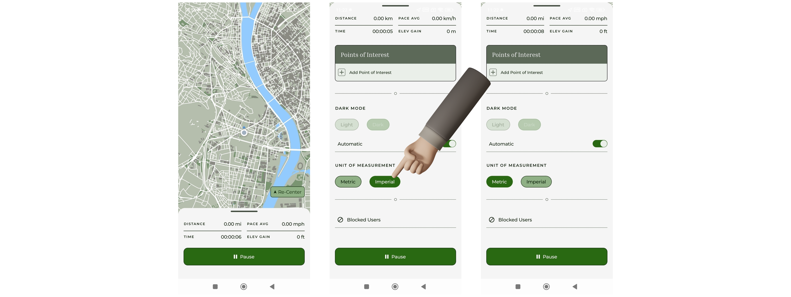

# Beállítások és lokalizáció

Az alkalmazás különböző beállítási lehetőségeket biztosít a felhasználói élmény személyre szabásához.

## Mértékegység rendszer

A felhasználó választhat metrikus és angolszász (imperial) mértékegység-rendszer között. A kiválasztott mértékegység az alkalmazás minden releváns felületén megjelenik, beleértve a túrák adatait és a valós idejű mérőszámokat is. A beállítás módosítása azonnal érvénybe lép, és az alkalmazás újraindítása után is megmarad.

/// caption
Mértékegység váltása
///

## Megjelenés (téma)

Az alkalmazás támogatja a világos és sötét megjelenési módot.

A felhasználó az alábbi lehetőségek közül választhat:

- világos mód,
- sötét mód,
- automatikus mód. (A rendszer beállításait követi.)

Automatikus mód esetén az alkalmazás a készülék aktuális témájához igazodik.

/// caption
Sötét és világos mód váltása
///

## Nyelvi beállítások

Az alkalmazás több nyelvet támogat, jelenleg magyar és angol nyelven érhető el. A kiválasztott nyelv az alkalmazás teljes felületére érvényes. A mobil eszköz nyelvi beállításainak megváltoztatása után az alkalmazást újra kell indítani, hogy a preferált nyelv megjelenjen.

## Rendszerszintű engedélykérések

Az alkalmazás bizonyos funkciók használatához (például helymeghatározás vagy értesítések) rendszerszintű engedélyeket kér. Ezek az engedélykérések a készülék operációs rendszerének nyelvén jelennek meg, és nem minden esetben követik az alkalmazásban kiválasztott nyelvet. Az engedélykérés előtt azonban minden esetben megjelenik egy alkalmazáson belüli tájékoztató felület.
