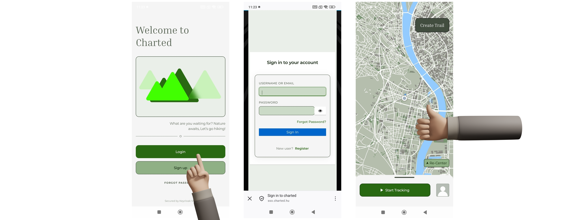
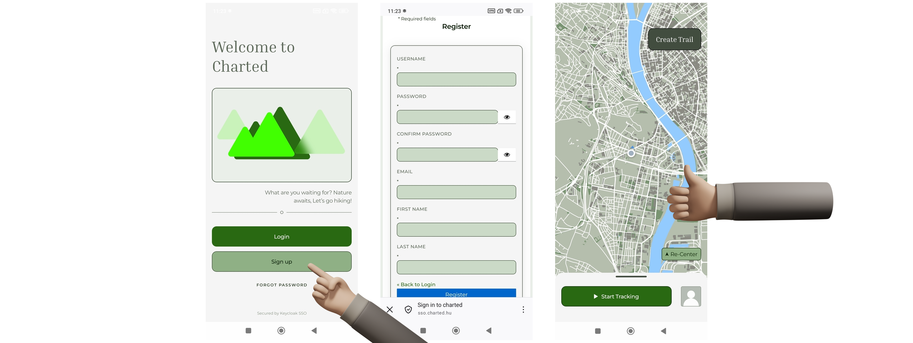
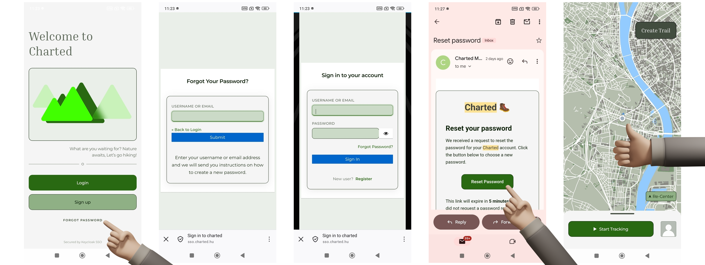

# Regisztráció és bejelentkezés

Az alkalmazás használatához felhasználói fiók szükséges. A felhasználók regisztrációt követően tudnak csak bejelentkezni az alkalmazásba.

## Bejelentkezés

Az alkalmazás megnyitásakor a felhasználó egy bejelentkezési felületet lát, ahol lehetőség van:

- bejelentkezésre,
- regisztrációra,
- elfelejtett jelszó igénylésére.

A bejelentkezés egy webes autentikációs felületen történik. Sikeres autentikáció után az alkalmazás automatikusan visszanavigál az alkalmazásba, és a felhasználó a térkép nézetre kerül.

/// caption
Bejelentkezési folyamat
///

## Regisztráció

A regisztráció szintén webes felületen történik. A felhasználónak meg kell adnia a szükséges, csillaggal jelölt adatokat (jelenleg felhasználónév, email cím, jelszó, jelszó újra és két név).

Sikeres regisztráció után az alkalmazás automatikusan bejelentkezteti a felhasználót, és a főoldalra navigálja.

/// caption
Regisztrációs folyamat
///

## Elfelejtett jelszó

Elfelejtett jelszó esetén a felhasználó egy webes felületen a jelszó-visszaállítás lehetőségével is élhet. A szükséges adatok megadását követően a rendszer emailben küld egy visszaállító linket. Az emailes linken való módosítás után megjelenik egy új beviteli mező, ahová a felhasználó az új jelszavát megadhatja, mellyel extra lépések nélkül be is léphet az alkalmazásba.

/// caption
Elfelejtett jelszó folyamata lépésenként
///

## Session kezelés

Sikeres bejelentkezést követően a felhasználó autentikált állapotban marad az alkalmazás újranyitása után is.

A felhasználó manuálisan kijelentkezhet a profil felületen keresztül, amely után az alkalmazás visszanavigál a bejelentkezési képernyőre. Ezt az alábbi módon kísérelheti meg:

- profil oldalra navigál,
- a felhasználói kártyája jobb felső sarkában található hárompötty gombot megnyomja,
- a piros kijelentkezés gombot megnyomja a megjelenő modálon.

Offline állapotban a korábban hitelesített felhasználó továbbra is bejelentkezve marad, azonban az online funkciók nem érhetők el.
