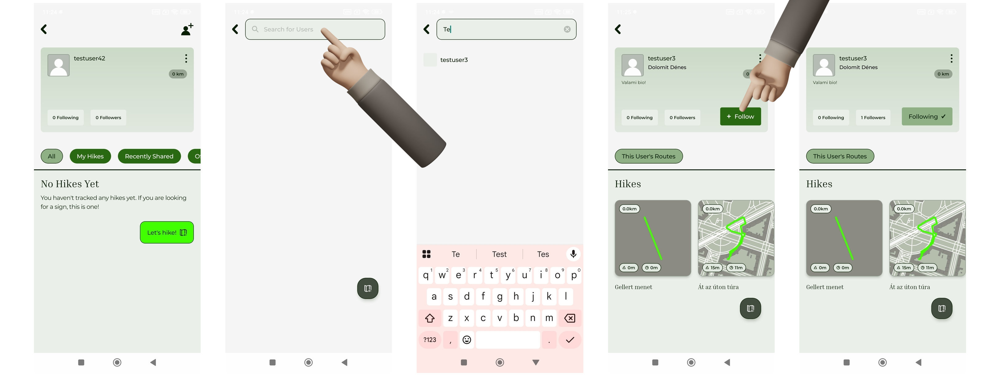
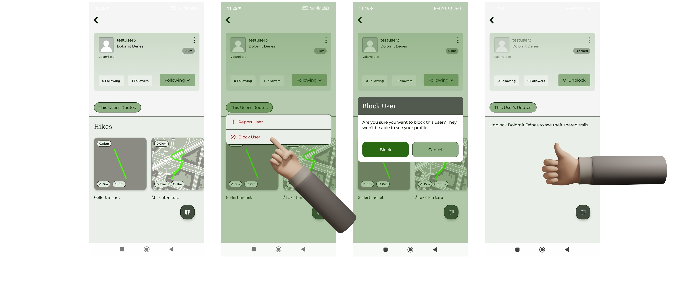
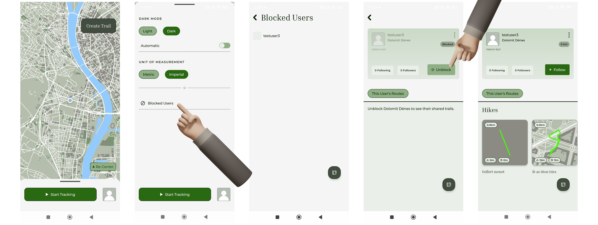
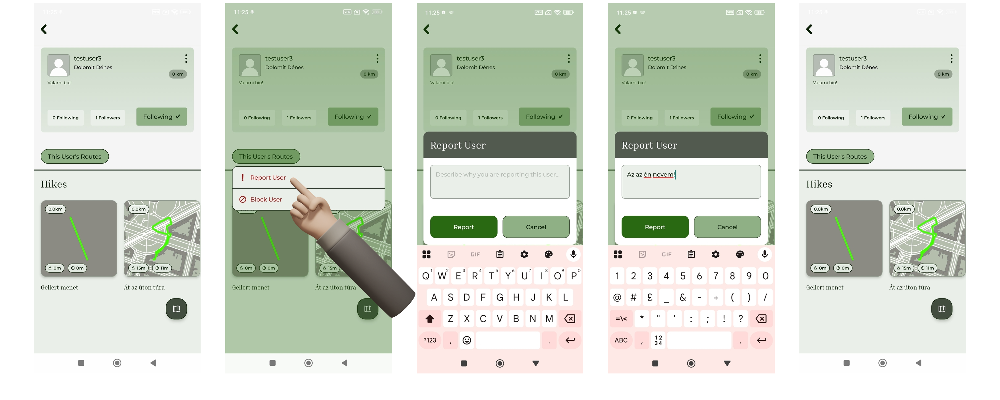

# Közösségi funkciók

Az alkalmazás közösségi funkciókat biztosít felhasználói számára, melyek lehetővé teszik más felhasználók megtalálását, követését, blokkolását és a velük való interakciót.

## Felhasználók keresése

A felhasználó keresés funkció segítségével más felhasználókat találhat meg felhasználónév alapján. A keresés gomb a profil képernyő jobb felső sarkában található meg.

A keresési találatok listában jelennek meg, ahonnan kiválasztható egy adott felhasználó. A listában csak azok a felhasználók jelennek meg, akikkel nem vagyunk valamilyen blokk kapcsolatban:

- nem blokkoltak minket,
- nem blokkoltuk őket.

/// caption
Felhasználó keresése, profil megtekintése és követése
///

## Profil megtekintése

Egy másik felhasználó kiválasztása után megjelenik annak profil oldala. Másik felhasználó profiljára navigálásra mások által bejárt túraútvonal részletes nézetéről is van lehetőség.

A profil oldalon láthatók:

- a felhasználó alapadatai, köztük az általa megtett össz távolság,
- a megosztott túrák,
- a követők és követések száma.

## Követés és kikövetés

A felhasználó lehetőséget kap más felhasználók követésére is. Követés esetén a kapcsolat létrejön és a követési adatok frissülnek. A követés bármikor megszüntethető (kikövetés), amely után a kapcsolat megszűnik.

## Blokkolás és feloldás

A felhasználó blokkolhat más felhasználókat.

Blokkolás esetén:

- a blokkolt felhasználó tartalma nem érhető el,
- a felhasználók közötti kapcsolat megszűnik,
- nem jelennek meg a keresésekben,
- nem tudnak ránk keresni,
- ha követési kapcsolat volt a blokkolt és blokkoló között, a rendszer automatikusan kiköveti.

/// caption
Felhasználó blokkolása
///

A blokkolás később feloldható, amely után a felhasználók ismét elérhetővé válnak egymás számára. A feloldásra a térkép oldalon az alsó modulon van lehetőség.

/// caption
Blokkolt felhasználó feloldása
///

## Felhasználó jelentése

A felhasználó lehetőséget kap más felhasználók jelentésére. A jelentés során indoklás megadása szükséges. Sikeres elküldés után a rendszer visszajelzést ad a művelet végrehajtásáról. A felhasználó egyszer tud egy másik felhasználót jelenteni, más esetekben a rendszer jelzi, hogy a jelentés sikertelen.

/// caption
Felhasználó jelentése
///
